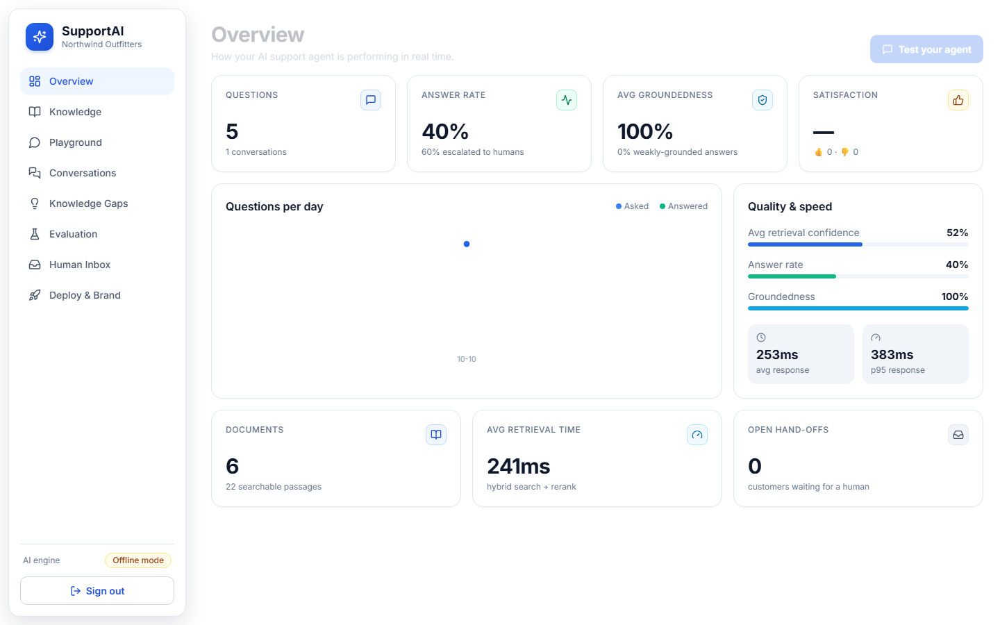

# SupportAI — Intelligent Customer Support Agent

Upload FAQs, PDFs, DOCX files or URLs → get an **evidence-grounded AI support chatbot** you can embed on any website with one line of code.

Unlike basic RAG chatbots, SupportAI combines **hybrid retrieval, source-level citations, confidence-aware human fallback, automatic knowledge-gap discovery, multitenant isolation and built-in evaluation**.



## Quick start

```powershell
.\start.ps1            # Windows: creates venv, builds UI, starts on http://localhost:8000
```
or with Docker: `docker compose up --build`.

1. Open <http://localhost:8000/signup>, create a workspace.
2. **Knowledge → Load sample data** (a demo outdoor-gear store, incl. a 2-page PDF).
3. **Playground** → ask questions; inspect citations, confidence, retrieved evidence.
4. **Deploy & Brand** → copy the `<script>` snippet, or open the demo storefront.

Optional: `$env:ANTHROPIC_API_KEY="sk-ant-..."` before starting switches from the offline extractive answerer to Claude-written, cited answers (and an LLM judge in evaluation). Everything else works without a key.

## Feature map (matches the problem brief)

| Brief requirement | Where |
|---|---|
| Document ingestion (PDF, DOCX, FAQ, URL) | `backend/app/ingest.py` — PyMuPDF (page numbers), python-docx, trafilatura; heading-aware chunking with page/section metadata |
| Hybrid RAG + rerank | `backend/app/retrieval.py` — BGE-small dense + SQLite FTS5/BM25, fused with Reciprocal Rank Fusion, reranked by a cross-encoder |
| Grounded answers + citations | `llm.py`, `chat.py` — answers only from numbered sources; each citation has doc, page, section and snippet |
| Confidence-aware fallback | blended reranker + cosine confidence vs. per-tenant threshold → "Talk to a human" → Human Inbox |
| Knowledge-gap detection | `gaps.py` — agglomerative clustering of unanswered/downvoted questions → suggested FAQ → one-click publish |
| Multitenant security | JWT auth, `tenant_id` on every table and every query, isolation tests in `tests/` |
| Automatic evaluation | `evaluation.py` — golden Q&A set → hit@3 (vs. vector-only baseline), accuracy, groundedness, hallucination rate, fallback accuracy, p50/p95 latency |
| One-click deployment | `widget/widget.js` — Shadow-DOM glassmorphism widget, branding, feedback, hand-off form |
| Analytics | Overview page: answer rate, escalations, groundedness, satisfaction, latency, trend |

## Architecture

```
Dashboard (React/Tailwind) ─┐                     ┌─ Customer site: <script data-bot-id> widget
                            ▼                     ▼
                     FastAPI  (/api  +  /api/public/{bot_id})
   upload → parse → chunk(page, section) → embed(BGE) → SQLite (chunks + FTS5)
   question → dense top-20 ┐
                           ├─ RRF fuse → cross-encoder rerank → confidence gate
              BM25 top-20 ─┘                      │
                              ┌───────────────────┴──────────────┐
                        ≥ threshold                          < threshold
              LLM answers from sources only            fallback + human hand-off
              + citations + groundedness score         + logged as knowledge gap
```

## Stack

React 18 · Vite · Tailwind · FastAPI · SQLite (FTS5) · fastembed (`BAAI/bge-small-en-v1.5`, `ms-marco-MiniLM` reranker, ONNX, CPU) · Claude (optional) · Docker.

> **Design note:** the hackathon brief suggests PostgreSQL + pgvector/Qdrant. For zero-setup demos we use SQLite with FTS5 and in-memory cosine search (per-tenant matrices). The retrieval layer is isolated in `retrieval.py`, so swapping to pgvector is a contained change.

## Tests & verification

```powershell
cd backend; .\.venv\Scripts\python -m pytest tests -q      # API, citations, fallback, tenant isolation, gaps loop, eval
.\.venv\Scripts\python ..\scripts\calibrate.py              # confidence separation: in-scope vs out-of-scope
.\.venv\Scripts\python ..\scripts\ui_smoke.py               # drives the real UI with Playwright + refreshes docs/screenshots
```

## 3-minute demo script

1. Sign up → **Load sample data** (5 sources).
2. Playground: "How much is standard shipping?" → cited answer. "How do I wash a down sleeping bag?" → cites **product_care_guide.pdf · p.2**.
3. Ask "Do you offer gift wrapping?" three ways → low-confidence fallback each time.
4. **Knowledge Gaps**: the 3 questions are clustered; write the answer, **Publish** → ask again, now answered.
5. **Evaluation → Run**: hit@3, accuracy, groundedness, hallucination rate, latency.
6. **Deploy**: copy the snippet / open the demo storefront; chat in the widget, click *Talk to a human*, see it in **Human Inbox**.
